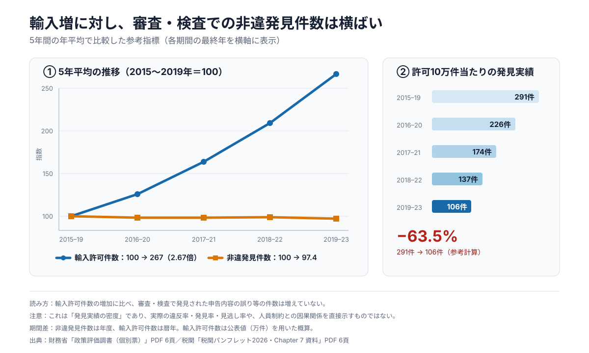

# 税関業務の課題整理メモ

税関業務をめぐる公開情報を、提案検討の出発点として整理するリポジトリです。

## 情報の区分

本文中の記述は、次のいずれかを明示します。

- **事実**：一次資料で確認できた内容。出典URLと該当ページを併記します。
- **計算・解釈**：一次資料の数値から行った計算、または資料を踏まえた解釈です。事実そのものとは区別します。
- **未検証の仮説**：今後、公開情報、業務ヒアリング、または検証可能なデータで確かめる必要がある問いです。現時点の事実として扱いません。

## 文書

- [As-Is簡易版：輸入急増と審査・検査能力の制約](notes/00-as-is-summary.md)
- [背景・As-Isと検討課題](notes/01-background-as-is.md)
- [現在確認できる問題と、その背景に関するエビデンス](notes/02-current-problems-evidence.md)
- [To-Be方針：区分2・3の書類審査に処理余力を生み出す](notes/03-to-be-direction.md)
- [なぜNTTデータか：通関・貿易領域の実績と提案上の意味](notes/04-why-ntt-data.md)
- [提案ストーリー草案：As-Isから審査支援システムまで](notes/05-proposal-storyline.md)

## 参考スライド

- [提案ストーリー参考版（PowerPoint）](slides/reference-proposal-storyline.pptx)

**計算・解釈**：上記スライドは、現時点のストーリーを可視化した検討用の参考版であり、最終提案資料ではない。具体的な効果数値、業務負荷、システム構成および既存資産の利用可能性は未検証である。

## 主要グラフ

**計算・解釈**：輸入許可件数の増加に比べ、審査・検査で発見された申告内容の誤り等の件数は増えておらず、許可10万件当たりの発見実績は参考計算で約63.5%低下した。これは実際の違反率・発見率・見逃し率や、人員制約との因果関係を直接示すものではない。数値、計算方法、期間差および出典はリンク先に記載する。

## 公開範囲と対象外

- **事実**：このリポジトリには、公開済みの一次資料から確認できる情報だけを掲載します。
- **事実**：インターン内部の非公開情報、個人情報、秘密情報は掲載しません。
- **計算・解釈**：To-Beの方向性は整理済みだが、具体的な施策、製品選定、システム構成、接続方式および導入方式はまだ確定しません。
- **計算・解釈**：数値から業務上の含意を述べる場合は、計算式、前提、限界を併記します。
- **未検証の仮説**：書類審査のボトルネック、原因、改善余地は、検証が済むまで仮説として管理します。

## 主な一次資料

- 財務省関税局「税関中長期構想 2030」（2026年6月）  
  https://www.customs.go.jp/zeikan/seido/smart/honbun2030.pdf
- 税関「税関パンフレット 2026・Chapter 7 資料」  
  https://www.customs.go.jp/zeikan/pamphlet/report/pdf/report_008j.pdf
- [財務省「政策評価調書（個別票）政策目標5-3」（令和5年度実績評価）](https://www.mof.go.jp/about_mof/mof_budget/budget/fy2025/kobetuhyou2025-15.pdf)
- 財務省「令和6事務年度における関税等脱税事件に係る犯則調査の結果」  
  https://www.mof.go.jp/policy/customs_tariff/trade/collection/ka20251112a3_all.pdf
- 財務省「令和6事務年度における輸入事後調査の結果」  
  https://www.mof.go.jp/policy/customs_tariff/trade/collection/ka20251112b3_all.pdf
- 財務省「令和7年の全国の税関における関税法違反事件の取締り状況」  
  https://www.mof.go.jp/policy/customs_tariff/trade/safe_society/mitsuyu/cy2025/ka20260217.pdf
- 財務省「令和8年上半期の全国の税関における関税法違反事件の取締り状況」  
  https://www.mof.go.jp/policy/customs_tariff/trade/safe_society/mitsuyu/cy2026_1/ka20260925.pdf
- 財務省「令和8年上半期の税関における知的財産侵害物品の差止状況」  
  https://www.mof.go.jp/policy/customs_tariff/trade/safe_society/chiteki/cy2026_1/ka20260904.pdf

## 公開前チェック

- 数字を一次資料の原表・原図と照合したか
- 事実に出典URLと該当ページがあるか
- 計算式、単位、丸め方、比較期間を明示したか
- 推測を「未検証の仮説」として区別したか
- 非公開情報が混入していないか
- To-Beやシステム構成を確定事項として書いていないか
